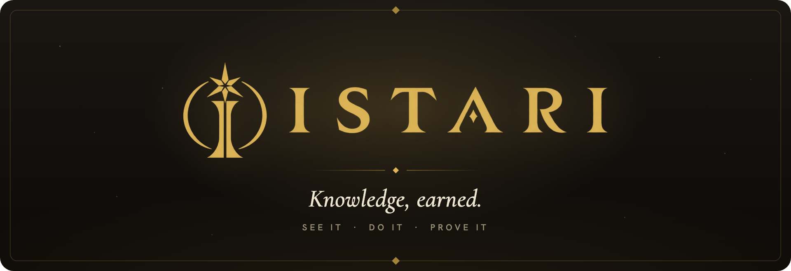
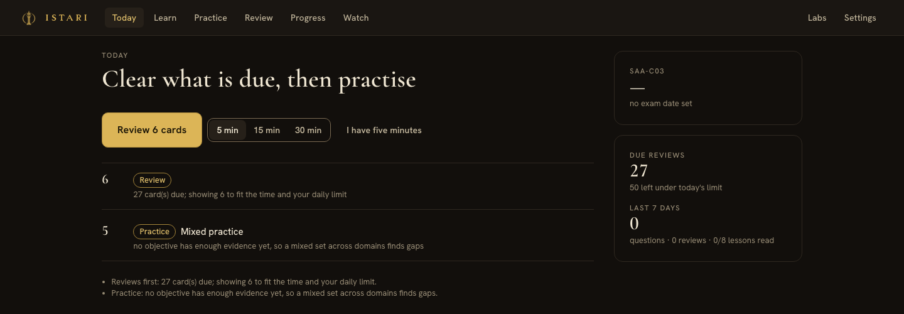
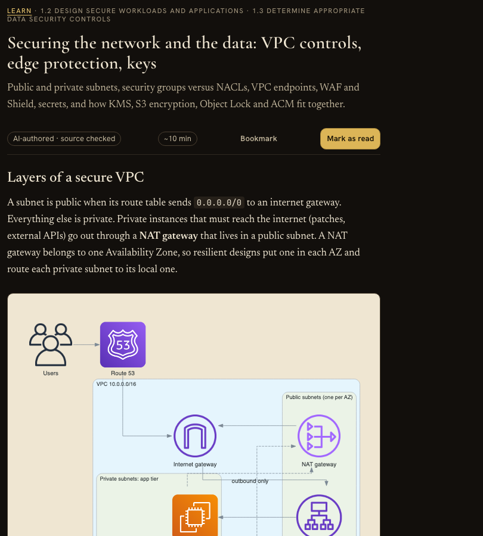
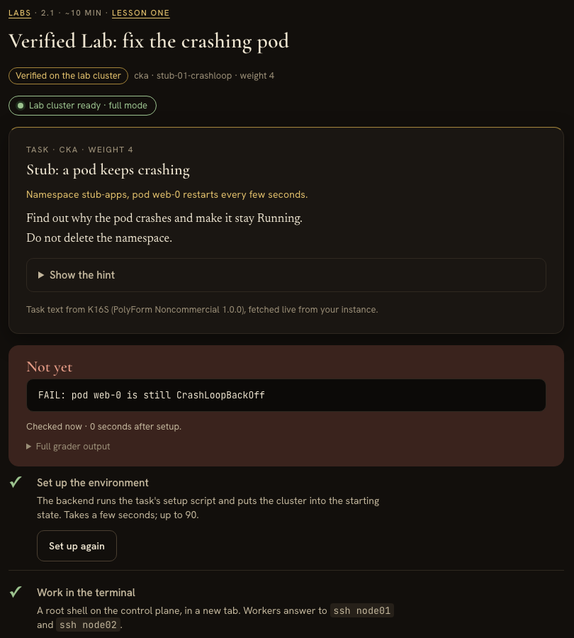
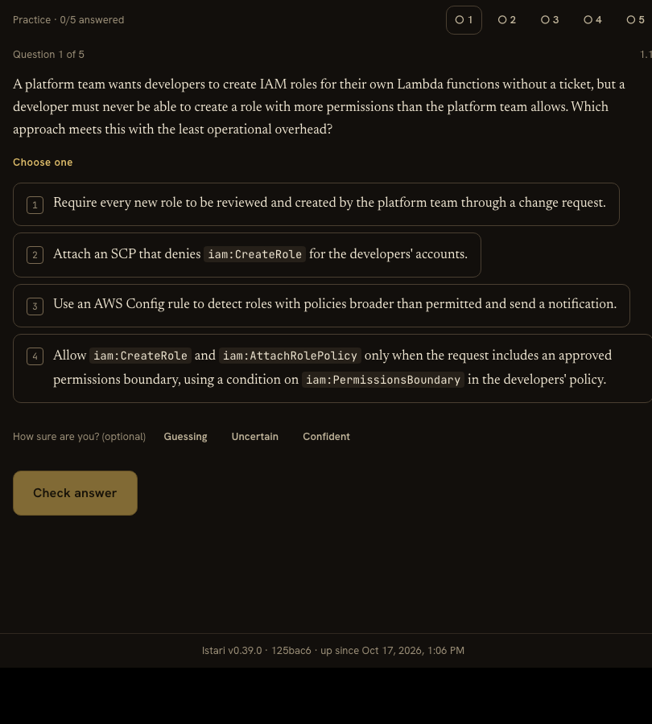
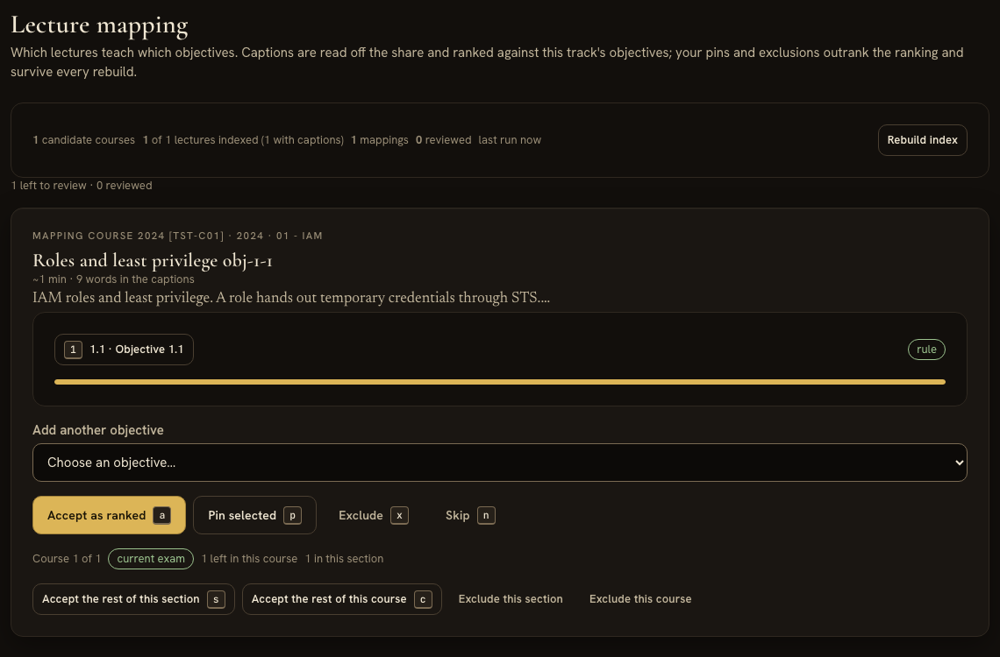
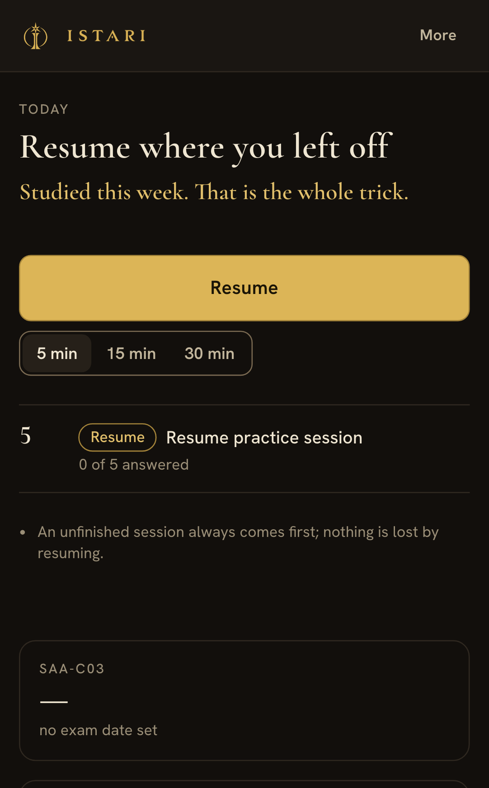
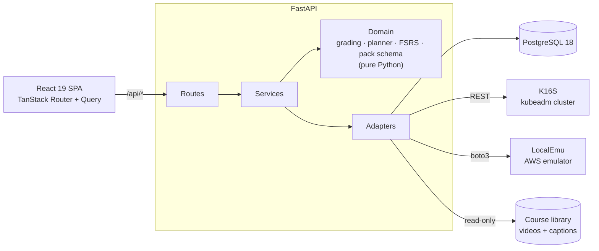

<p align="center">
  
</p>

<p align="center">
  
  
  
  
  
  
</p>

<p align="center">
  <a href="#see-it-do-it-prove-it">The loop</a> ·
  <a href="#whats-inside">What's inside</a> ·
  <a href="#tracks">Tracks</a> ·
  <a href="#how-its-built">How it's built</a> ·
  <a href="#run-it">Run it</a> ·
  <a href="#docs">Docs</a>
</p>

---

**Istari is a certification trainer built for exactly one learner.** It shows you the thing,
has you do the thing on real infrastructure, and keeps the evidence. It never tells you
you're "87% ready", because nobody knows that, and a number that pretends to is worse than
no number at all.

Open it and it tells you what to do next and why: clear the reviews that are due, practise
your weakest objective, run one verified lab if you have half an hour. Every recommendation
carries its reason, in a sentence you can argue with.

<p align="center">
  
</p>

## See it, do it, prove it

Every lesson is built around the same three moves.

<table>
  <tr>
    <td width="33%" valign="top">
      <h3>See it</h3>
      Short lessons with a drawing of the thing they teach, as pack content attached to the
      exam's objectives. A lecture you watch borrows the figures of the objectives it covers.
    </td>
    <td width="33%" valign="top">
      <h3>Do it</h3>
      Every lesson ends in a lab, inline. Kubernetes labs run on a real kubeadm cluster;
      AWS labs run against an AWS emulator in the lab. Either way a machine grades it, not you.
    </td>
    <td width="33%" valign="top">
      <h3>Prove it</h3>
      Scenario questions graded on the server, your confidence recorded beside each answer,
      and progress shown as evidence per objective: first attempts, repeats, labs passed.
    </td>
  </tr>
  <tr>
    <td></td>
    <td></td>
    <td></td>
  </tr>
</table>

## What's inside

**Today.** An explainable daily plan for 5, 15 or 30 minutes. An unfinished session comes
first, then due reviews (capped by your daily limit, gentler in backlog-recovery mode), then
practice aimed at your weakest objective, then a verified lab, a lesson or a lecture if
there's room. Missed days are never punished; overdue cards are simply due.

**Learn.** Lessons per objective, each with sources and the date they were checked, figures
drawn with [diagrams](https://diagrams.mingrammer.com/) and committed as self-contained SVG,
notes beside the text, and a "Do it" step that runs the lesson's labs in place.

**Practice.** Scenario questions in the exam's style, single and multiple answer, graded on
the server, so the answer key reaches the browser only after you answer. Rate your confidence first and Istari
keeps a list of *confident mistakes*: the answers you were sure of and got wrong, which are
the most valuable ones to revisit. Any of them becomes a review card in one click.

**Review.** Spaced repetition scheduled with [FSRS](https://github.com/open-spaced-repetition/py-fsrs),
with a daily limit and a backlog-recovery mode for the week you fell behind.

**Verified labs.** A lab brief can name a backend that sets the task up and grades it:

- [K16S](https://github.com/immanuwell/k16s-exam-simulator) for Kubernetes. It is a real
  kubeadm cluster with a browser terminal. Istari stores only question ids; the task text
  is fetched live and attributed.
- LocalEmu for AWS: an AWS emulator with IAM enforcement on. The scenarios are Istari's
  own: setup builds the starting state, you work with the AWS CLI in your own shell, and the
  check reads the state back clause by clause. Nothing ever touches a real AWS account.

The first graded attempt is the evidence. A re-check after a fix is recorded too, as a
repeat. The planner schedules a lab only while its backend answers.

**Watch.** Point Istari at your own library of video courses and it becomes a study tool.
Captions are indexed against the exam's objectives, so every lecture knows what it teaches.
Lectures without captions get them, transcribed locally with Parakeet. A review queue lets
you pin or exclude the mapping a lecture at a time, or a section at a time. Courses are
compared on coverage and currency, never a quality score. Each objective gets a *master
path*: one learning path composed across every course you own, the best continuous run
first, older-exam courses stepping aside, yours to reorder.

**Progress.** Per domain and objective: lessons read, first-attempt accuracy, repeats,
assessments, labs, and an evidence state that says *insufficient evidence* until there is
some. Watch outcomes show whether watching a lecture actually moved your first attempts.

**On a phone.** A bottom tab bar, a focus mode for sessions, and the same plan.

<p align="center">
  
  &nbsp;
  
</p>

### What it refuses to do

- **No readiness percentage and no pass prediction.** Evidence, not prophecy.
- **No content generated at runtime.** Every lesson, question and figure is reviewed pack
  content with sources and an authorship record. The starter packs are AI-authored, and
  the app labels them as such.
- **No accounts, no sign-up, no multi-user.** One owner, created from the command line.
- **No cloud bill.** Istari provisions nothing and holds no AWS credentials.
- **No guessing on the grader's behalf.** A check that cannot grade, because the lab was never
  set up or the emulator restarted, says so and records nothing.

## Tracks

| Track | See it | Do it |
|---|---|---|
| **AWS Certified Solutions Architect - Associate** (SAA-C03) | 8 lessons, 10 figures, 40 questions, 24 cards | 6 labs: 4 graded on the AWS emulator, 2 briefs for your own account |
| **Certified Kubernetes Administrator** (Kubernetes v1.35) | Labs first; lessons to come | 36 labs, all graded on K16S |

The SAA-C03 pack carries the official exam guide's task statements, knowledge and skills
verbatim, with its in-scope and out-of-scope service appendix, and every item is sourced to
AWS documentation with the date it was checked. Packs are plain JSON
([`docs/content-schema.md`](docs/content-schema.md)); importing one is idempotent, and an
edit makes a new revision so past answers keep pointing at the text you actually saw.

## How it's built



- **Backend:** Python 3.13, FastAPI, SQLAlchemy 2 async on asyncpg, Alembic, py-fsrs,
  argon2. The layers are enforced by import-linter: routes call services, and the domain
  imports no framework at all. Typed with mypy strict, linted with ruff.
- **Frontend:** React 19, TypeScript, Vite 8, TanStack Router and Query, zustand. Styled
  by the Istari design system, which owns the tokens and component rules while the code owns
  the markup. It is set in Cormorant Garamond, Hanken Grotesk, Newsreader and JetBrains Mono.
- **Tests:** pytest against a real migrated Postgres, Vitest and Testing Library, and
  Playwright on desktop, mobile and ultrawide viewports. AWS scenarios are tested on moto,
  and the K16S and LocalEmu edges against in-process stubs.
- **Shipping:** GitHub is the source of truth. A pull mirror in the owner's lab builds a
  hardened image, and Flux rolls it out. The container migrates, seeds and bootstraps the
  owner from a vault on first start.

## Run it

Istari is built for one person's homelab, but it runs anywhere you have Python, Node and
Postgres:

```sh
cp .env.example .env                    # set POSTGRES_PASSWORD first
make setup                              # install, start Postgres, migrate, seed the packs
make bootstrap-owner USERNAME=<you>     # prompts for the password; there is no default
make dev                                # API on :8000, the app on :5173
```

You need Python 3.13 with [`uv`](https://docs.astral.sh/uv/), Node 22+ with `pnpm`, and
Docker for Postgres. Log in, pick a track, and start a five-minute session from Today.
Everything optional switches on with one variable, and the app explains what's missing
when it isn't set:

| Variable | Turns on |
|---|---|
| `LEARNING_ROOT`, `LEARNING_TOPICS` | Watch: your video library, read in place, never written |
| `K16S_BASE_URL`, `K16S_PUBLIC_URL` | Kubernetes labs on your K16S instance ([`docs/labs-k16s.md`](docs/labs-k16s.md)) |
| `LOCALEMU_BASE_URL` | AWS labs on your LocalEmu emulator ([`docs/labs-localemu.md`](docs/labs-localemu.md)) |

<details>
<summary><b>Make targets</b></summary>

`make help` lists everything. The ones you'll use:

| Target | Does |
|---|---|
| `make dev` | API and Vite dev servers |
| `make test` | pytest (real Postgres) and Vitest |
| `make e2e` | builds the SPA, runs Playwright on three viewports |
| `make lint` / `make typecheck` / `make validate` | ruff, ESLint, Prettier; mypy, tsc; architecture, module-shape and version gates |
| `make seed` | imports every `content/packs/*/pack.json` |
| `make figures` / `make figures-check` | draws the pack figures; catches drift |
| `make labs-check` / `make aws-labs-check` | checks the labs against K16S and LocalEmu (not gates; they need the backends) |
| `make transcribe SRC=<dir>` | captions for lectures that have none |
| `make backup` / `make restore` | `pg_dump`, and a restore into an isolated database |
| `make docker-build` / `make docker-up` | the hardened container stack |

</details>

<details>
<summary><b>Environment</b></summary>

`.env.example` has the full list. `DATABASE_URL` is required and has no default;
`TEST_DATABASE_URL` defaults to it with `_test` appended. `TIMEZONE` sets the display
timezone (storage is UTC). Set `SESSION_COOKIE_SECURE=true` behind HTTPS. `GIT_COMMIT` and
`BUILD_DATE` are stamped into the image, and every page's footer shows them.
[`docs/deployment.md`](docs/deployment.md) covers the rest.

</details>

<details>
<summary><b>Working on it</b></summary>

Every commit bumps `VERSION` and adds a `CHANGELOG.md` entry, and pre-commit runs
detect-secrets, gitleaks and the repository gates. The interactive API docs are at
`/api/docs`, and the OpenAPI spec is at `/api/openapi.json`. Agents working here start with
[`AGENTS.md`](AGENTS.md); work is tracked in this repository's issues.

</details>

## Docs

| Doc | Covers |
|---|---|
| [`docs/architecture.md`](docs/architecture.md) | Layers, the planner, styles and the design system's split of authority |
| [`docs/content-schema.md`](docs/content-schema.md) | Packs, items, scoring, revisions, verifiers |
| [`docs/labs-k16s.md`](docs/labs-k16s.md) | Kubernetes labs graded by K16S |
| [`docs/labs-localemu.md`](docs/labs-localemu.md) | AWS labs graded against LocalEmu, and how to write a scenario |
| [`docs/figures.md`](docs/figures.md) | How the figures are drawn and kept honest |
| [`docs/corpus.md`](docs/corpus.md) | Purchased course material: a private corpus, never committed |
| [`docs/deployment.md`](docs/deployment.md) | Running it somewhere |

## Credits

The fonts are Cormorant Garamond, Hanken Grotesk, Newsreader and JetBrains Mono, shipped
under the SIL Open Font License. Kubernetes tasks come from
[K16S](https://github.com/immanuwell/k16s-exam-simulator) (PolyForm Noncommercial 1.0.0),
fetched live and never stored here. AWS service icons in the figures come from
[diagrams](https://diagrams.mingrammer.com/). Every pack item cites the official
documentation it was checked against. The design system was made in Claude Design, and most
of the code was written with Claude Code.

<p align="center"><sub><i>Knowledge, earned.</i></sub></p>
